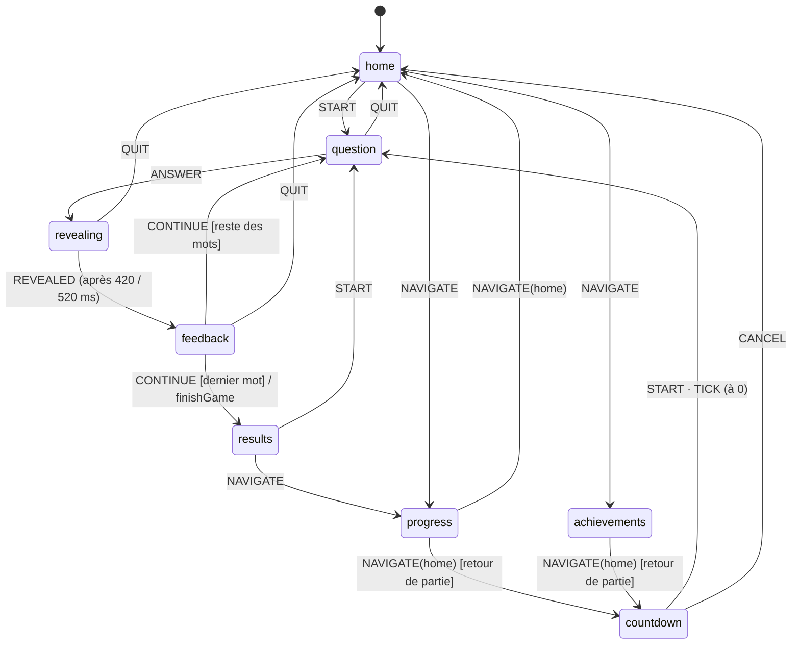

# Le ou la ?

Jeu mobile pour apprendre le genre des noms français. JavaScript pur, aucune dépendance, aucun service externe : tout est stocké dans le navigateur, et les polices (Young Serif, Manrope — licence SIL OFL 1.1) sont hébergées dans `fonts/`.

Pour jouer, ouvrir `index.html` dans le navigateur : ni serveur ni Node ne sont nécessaires.

```sh
npm test    # 59 tests, avec le lanceur intégré de Node (≥ 20)
```

## Architecture

Les dépendances vont toujours vers le centre : l'interface connaît l'application, l'application connaît le domaine, le domaine ne connaît personne.

```
src/
├── data/words.js              Données brutes : 34 groupes, 214 mots (dont 18 sans règle)
├── domain/                    Règles du jeu, sans DOM ni stockage
│   ├── gender.js              Gender           objet valeur (le / la)
│   ├── wordBank.js            WordGroup, Word, WordBank   invariant régulier / exception
│   ├── difficulty.js          Difficulty       0 → 100, +4 / −6 par réponse
│   ├── wordStats.js           WordStat, WordStatsBook     taux de réussite par mot
│   ├── wordSelection.js       WordSelectionPolicy         tirage 20 / 30 / 50 %
│   ├── gameSession.js         GameSession      agrégat « partie en cours »
│   ├── gameRecord.js          GameRecord       partie terminée, archivée
│   ├── playerProfile.js       PlayerProfile    agrégat « joueur »
│   ├── calendar.js            ActivityCalendar série quotidienne
│   ├── achievements.js        succès et paliers Bronze / Argent / Or
│   ├── progressReport.js      chronologie, tendance, message du coach
│   └── gameSummary.js         verdict et bilan de fin de partie
├── application/
│   ├── useCases.js            cas d'utilisation (orchestrent domaine + ports)
│   ├── stateMachine.js        moteur d'automate générique
│   └── appMachine.js          automate de l'application
├── infrastructure/            Adaptateurs des ports
│   ├── localStorageRepository.js   profil + préférences, migration v1 → v2
│   └── webAudioSound.js            sons de xylophone synthétisés
├── ui/                        Abonnés et pilotes de l'automate
│   ├── views.js               une vue par état, HTML pur
│   ├── renderer.js            rendu complet ou ciblé selon la transition
│   ├── controller.js          clics, survol, clavier → événements
│   ├── effects.js             sons et vibrations selon les transitions
│   └── format.js              textes français (dates, durées, messages)
└── main.js                    point d'assemblage
```

Les fichiers sont des scripts classiques (pas des modules ES, que les navigateurs refusent de charger en `file://`). Chacun s'enveloppe dans une fonction, lit ses dépendances dans l'espace de noms global `LeOuLa` et y publie ce qu'il exporte. `index.html` les charge dans l'ordre des dépendances ; un nouveau fichier doit y être ajouté après ceux qu'il utilise. Les tests chargent les scripts dans ce même ordre (`tests/game.js`) et vérifient donc qu'il est correct.

## Automate de l'application



- Tout événement sans transition dans l'état courant est **ignoré** : un double appui, un « Continuer » tardif ou une touche du clavier hors contexte ne peuvent pas corrompre une partie.
- `countdown` émet `TICK` chaque seconde (`every`), `revealing` émet `REVEALED` après un délai (`after`). Les minuteries sont annulées à la sortie de l'état.
- Transitions internes (sans changement d'état) : `TICK` tant qu'il reste du temps, `SELECT_BADGE`, `CLOSE_BADGE`, `TOGGLE_SOUND` (global). L'interface les traite par une mise à jour ciblée, sans redessiner l'écran.
- Les événements envoyés pendant une transition sont mis en file (« run-to-completion »).

## Règles métier, où les trouver

| Règle | Emplacement |
|---|---|
| Un mot régulier a le genre de son groupe, une exception le genre opposé | `Word` (constructeur) |
| Un mot sans groupe ne suit aucune règle : ni régulier, ni exception, son genre s'apprend par cœur | `Word` (constructeur), `Word.followsRule` |
| Devant une voyelle ou un h muet, l'article s'élide (« l’ ») ; un h aspiré l'empêche (« le hérisson ») | `Word.elides`, champ `asp` des données |
| Mot élidé : les boutons affichent « l’ (m.) » / « l’ (f.) » ; l'explication dit « masculin » ou « féminin » | `ui/views.js` (question, explication, bilan) |
| Un mot en h doit déclarer son h aspiré ou muet ; un mot en y- ne s'élide pas | `Word` (constructeur), champ `asp` |
| Un enregistrement invalide est ignoré au chargement, le reste de l'historique est conservé | `PlayerProfile.fromSnapshot` |
| 20 % hasard · 30 % parmi les 20 mots les plus faibles (hors mots déjà vus dans la partie et mots à 80 % ou plus) · 50 % difficulté (mot qui suit sa règle, ou mot difficile : exception ou sans règle) | `WordSelectionPolicy.pick` |
| Tirage 0-100 > difficulté → mot régulier, sinon exception | `Difficulty.callsForException` |
| La difficulté monte de 4, baisse de 6, persiste entre les parties | `Difficulty`, `PlayerProfile.recordGame` |
| Le chrono ne compte que le temps de réflexion | `GameSession.thinkingTime` |
| Une partie abandonnée n'est pas enregistrée | `appMachine` (`leaveGame`), `PlayerProfile` |
| Chaque partie archive : date et heure de fin, durée, % de réussite, difficulté, réponses | `GameRecord.toSnapshot` |
| La chronologie s'affiche à partir de 3 parties | `ProgressReport.isUnlocked` |
| Après une partie, l'accueil lance la suivante dans 5 s | `appMachine` (`returningFromGame`, état `countdown`) |

## Ajouter des mots

Ajouter une entrée dans `src/data/words.js` (un mot en h doit préciser `asp: true` pour un h aspiré ou `asp: false` pour un h muet). Au chargement, `WordBank.fromData` vérifie les doublons, les groupes inconnus et la cohérence régulier / exception, et le test `wordBank.test.js` vérifie que chaque groupe garde au moins deux mots réguliers et au plus une exception.
